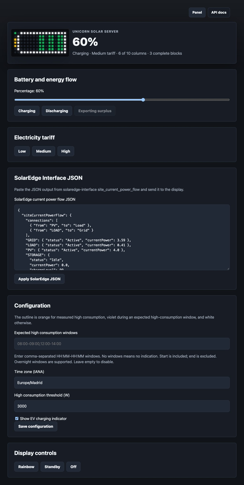
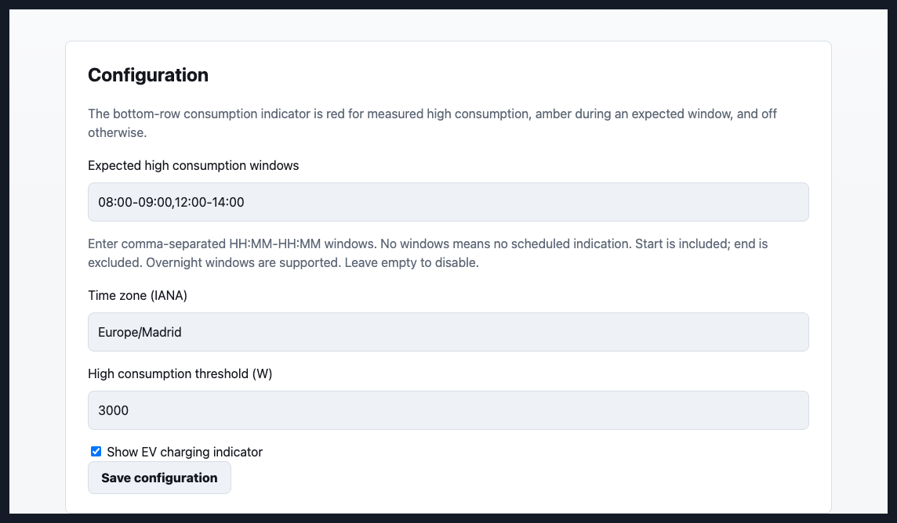

# Unicorn Solar Server

Display the battery, energy flow, and current electricity tariff of a domestic
solar installation on a Raspberry Pi with a Pimoroni Unicorn HAT Mini.

Current release: [v1.3.0](https://github.com/aspaviento/unicorn-solar-server/releases/tag/v1.3.0).
See the [changelog](CHANGELOG.md) for changes since v1.0.0 and the
[security policy](SECURITY.md) for supported releases and private reporting.

The project provides:

- A 17x7 battery display designed for Unicorn HAT Mini.
- A validated HTTP API for external solar-monitoring scripts.
- A dedicated API and web form for SolarEdge installations with solar panels
  and battery storage, accepting current power-flow JSON generated by
  [ndejong/solaredge-interface](https://github.com/ndejong/solaredge-interface).
- A responsive React control panel with a simulated matrix preview.
- Built-in API documentation.
- A systemd service and Raspberry Pi installation scripts.
- A hardware-free dummy mode for local development and automated tests.
- A startup rainbow that confirms the Unicorn HAT Mini is working before the
  first solar update arrives.



## Project lineage

Unicorn Solar Server is derived from
[aspaviento/unicorn-busy-server](https://github.com/aspaviento/unicorn-busy-server),
which is itself based on
[estruyf/unicorn-busy-server](https://github.com/estruyf/unicorn-busy-server).

The derived project reuses the Flask/Vite structure and Unicorn hardware
wrapper, but replaces the busy-light behavior with a solar battery display and
a dedicated API. It was developed with assistance from OpenAI Codex.

## Display

The server requires the Unicorn HAT Mini's native 17x7 orientation. It sets
rotation `0` and refuses to start with a different display shape so the battery
cannot be silently cropped or rotated.

- The battery outline is orange for measured high consumption, violet during
  an expected high-consumption period, and white otherwise.
- Five inner blocks of two columns represent battery percentage, filling from
  right to left in 10% steps while preserving the gaps between blocks.
- `0-9%` lights no columns. Each additional 10% lights one column, so `20%`
  completes the first block, `40%` completes the second, and `100%` completes
  all five blocks.
- Green columns mean charging.
- Red columns mean discharging.
- Blue columns mean exporting surplus energy. Exporting is accepted only at
  `100%`.
- The three-pixel battery terminal represents the electricity tariff: green
  for low, yellow for medium, and red for high.

The top-left pixel shows the latest local connectivity report.


| Battery level | Active columns | Complete blocks |
|---:|---:|---:|
| `0-9%` | 0 | 0 |
| `10-19%` | 1 | 0 |
| `20-29%` | 2 | 1 |
| `30-39%` | 3 | 1 |
| `40-49%` | 4 | 2 |
| `50-59%` | 5 | 2 |
| `60-69%` | 6 | 3 |
| `70-79%` | 7 | 3 |
| `80-89%` | 8 | 4 |
| `90-99%` | 9 | 4 |
| `100%` | 10 | 5 |

## Scheduling the panel with cron

For unattended Linux operation, the recommended approach is a small cron-driven
controller that posts current battery/tariff data during daylight and calls
`/api/standby` outside that period. Sunrise/sunset and live data come from your
own providers; the server does not retrieve or schedule them automatically.
All producers must respect the daylight gate, since battery or tariff updates
exit standby.

Follow the [step-by-step cron guide](docs/cron.md) and try the
[example shell script](examples/cron/panel-cron.sh) with its fictional JSON
fixtures in dry-run mode before connecting real data. Cron is optional and is
not installed automatically. Expected high-consumption windows, described
below, are a separate optional feature managed by the server itself.

## Household consumption and EV charging

The panel can optionally indicate daily periods when you expect high household
electricity consumption, for example from a pool filtration pump, an irrigation
system, or other scheduled motors. This gives context for the battery level
and energy flow without changing how those values or the tariff are displayed.

No expected windows are configured by default. When a valid power reading
meets the configured threshold, the outline is orange and takes priority over
violet. Otherwise, the outline follows the schedule, with white outside it.

To enable it, open **Configuration** in the web panel and enter daily windows
as comma-separated `HH:MM-HH:MM` ranges, for example:

```text
08:00-09:00,12:00-14:00
```

Select an IANA time zone (default `Europe/Madrid`) and click **Save
configuration**. Set the measured threshold in watts (default 3000) and choose
whether to show the EV charging indicator (enabled by default). A cyan pixel
in the bottom-left corner indicates confirmed charging in the solar view.
Battery fill, energy-flow colors, and the tariff terminal are independent of
the outline and EV indicator.

- Windows apply every day. Adjust them when seasonal equipment schedules change.
- Start is inclusive and end is exclusive: `08:00-09:00` ends at exactly 09:00.
- Overnight windows such as `23:00-01:00` are supported. Overlaps act as a union.
- Equal start/end, invalid times, and invalid time zones are rejected.
- Leave the windows field empty and save to disable the indication (the default).
- IANA time zones automatically follow daylight saving changes. Repeated local
  times use the same window on both occurrences; skipped local times never occur.
- A background monitor checks once per second; no new solar/tariff update or
  cron change is needed at window boundaries. Standby, off, and rainbow retain
  priority and are never interrupted by a schedule transition or settings save.
- The web preview polls status every five seconds. Its solar diagram remains
  informational even when the physical display is in another mode.



### Persistent configuration

Settings are stored atomically outside the source checkout, by default in
`~/.config/unicorn-solar-server/settings.json` for the **service user**.
`XDG_CONFIG_HOME` changes the configuration root; `UNICORN_SOLAR_SETTINGS_PATH`
can override the complete filename. The parent directory is created on first
save and must be writable by the service user. Back up this file separately
from the product source. No restart is needed after saving through the panel.

Settings survive service restarts and source deployments. A failed save returns
an error and retains the previous file and runtime configuration. If a file
cannot be read or validated at startup, the service logs the error and disables
the indication until valid settings are saved. A missing file uses defaults.
Manual file edits are loaded only on the next service start; prefer the panel.
The normal startup rainbow still waits for the next solar/tariff update.

## API

### Report local connectivity

```http
POST /api/connectivity
Content-Type: application/json

{"state": "connected"}
```

Call this endpoint over loopback from a connectivity monitor on the same host.
The pixel in the top-left corner is visible in the daytime view and standby
clock. It stays steadily lit according to the reported state.

| State | Pixel | Meaning |
| --- | --- | --- |
| `connected` | Green | The monitor can reach the local gateway. |
| `waiting_retry` | Orange | A check failed and the monitor is waiting to retry. |
| `recovering` | Orange | Recovery is in progress. |
| `disconnected` | Red | Recovery ended without restoring connectivity. |

The endpoint returns the current status. The `connectivity` field in that
response and in `GET /api/status` contains `state` and the UTC receipt time
`updatedAt`. After startup, the state is `unknown` and the pixel stays dark
until the first report. Updates preserve the display mode, including off and
rainbow.

### Read or save configuration

```http
GET /api/settings
POST /api/settings
Content-Type: application/json

{"windows": "08:00-09:00,12:00-14:00", "timezone": "Europe/Madrid", "highConsumptionThresholdW": 3000, "showEvCharging": true}
```

GET returns the saved configuration. POST requires `windows` and `timezone`.
Omitting `highConsumptionThresholdW` (a positive integer) or `showEvCharging`
(a boolean) preserves its saved value. Empty `windows` disables scheduled
indication. Invalid input returns HTTP 400 and a persistence failure returns
HTTP 500.

Producers can add optional top-level fields alongside `siteCurrentPowerFlow`
in `POST /api/solaredge-interface`: `householdPowerW` (instantaneous
household load in watts) and `evCharging` (boolean). Omitted or null values
mean unknown. The server applies the threshold on each update. Both readings
are cleared on standby or after ten minutes without an update. The standby
clock does not show the EV indicator.

`GET /api/status` reports those readings, `showEvCharging`, and
`highConsumptionMeasured` (boolean or null). `highConsumptionExpected`
remains a boolean computed from the configured schedule.

### Update battery

```http
POST /api/battery
Content-Type: application/json

{"percentage": 65, "flow": "charging"}
```

`percentage` accepts any number from `0` to `100`. `flow` accepts `charging`,
`discharging`, or `exporting`.

### Update from SolarEdge Interface

`POST /api/solaredge-interface` is designed for SolarEdge installations with
solar panels and battery storage. It accepts the JSON output produced by
[`ndejong/solaredge-interface`](https://github.com/ndejong/solaredge-interface):

```bash
solaredge-interface --format json site_current_power_flow <siteid> \
  | curl -X POST -H 'Content-Type: application/json' \
      --data-binary @- http://<raspberry-pi-ip>:9001/api/solaredge-interface
```

The endpoint uses `STORAGE.chargeLevel` for the battery percentage. The battery
flow follows `STORAGE.status`, while idle storage with exported power is
reported as `exporting`.

The control panel also includes a **SolarEdge Interface JSON** section where
the same JSON can be pasted and submitted manually.

The bar color follows the current power-flow connections and exported grid
power:

- Red when either of the first two connections originates from `GRID` or
  `STORAGE`.
- Blue when grid power is greater than `2.0`.
- Green when grid power is greater than `1.0`.
- Yellow otherwise.

### Update tariff

```http
POST /api/tariff
Content-Type: application/json

{"level": "low"}
```

`level` accepts `low`, `medium`, or `high`.

### Read status

```http
GET /api/status
```

The response includes the current solar state, `activeColumns` (`0-10`),
`activeBlocks` (`0-5` complete blocks), hardware type, display dimensions, and
rotation.

### Discover endpoints

```http
GET /api/
```

### Validate the display

The server starts with this rainbow animation instead of showing an empty
battery, making hardware and service startup failures easier to identify.

```http
POST /api/rainbow
Content-Type: application/json

{"brightness": 1, "speed": 0.1}
```

Both values are optional.

### Show standby clock

```http
GET /api/standby
```

`POST /api/standby` is also accepted. Standby shows a very dim `HH:MM` clock
 at brightness `0.05` for overnight visibility with minimal light. Repeated
standby calls are idempotent and keep the existing standby display running.
Any battery or tariff update stops standby and restores the solar display.

### Turn off the display

```http
GET /api/off
```

`POST /api/off` is also accepted. This stops any animation and turns off every
display pixel. Any battery or tariff update stops the rainbow, standby, or off
state and restores the solar display.

## Installation

The installer supports Raspberry Pi OS and Ubuntu:

```bash
curl -LSs https://raw.githubusercontent.com/aspaviento/unicorn-solar-server/master/install.sh | sudo bash -
```

Solar Server is installed as `unicorn-solar.service`, runs as the installing
user (`pi` on a normal Raspberry Pi install), and listens on port `9001`.

The installer is self-contained for the Python runtime used by this service. It
does not depend on Pimoroni's `unicornhatmini-python/install.sh` installer and
does not create a virtual environment with `--system-site-packages`. Instead it:

- installs base system packages needed to create and build Python virtual
  environments: `python3-pip`, `python3-dev`, and `python3-venv`;
- creates an isolated virtual environment at `/home/<user>/.env` by default;
- installs this project's `requirements.txt` into that virtual environment,
  including `unicornhatmini`, `unicornhat`, `RPi.GPIO`, `gpiozero`, `spidev`,
  and the Flask server dependencies;
- writes a systemd unit that starts the server with
  `/home/<user>/.env/bin/python`.

The Unicorn HAT Mini still requires SPI to be enabled on the Raspberry Pi. If
the HAT is newly installed or the OS image is fresh, enable SPI before starting
the service:

```bash
sudo raspi-config nonint do_spi 0
```

Pimoroni's
[Unicorn HAT Mini getting started guide](https://learn.pimoroni.com/article/getting-started-with-unicorn-hat-mini)
is useful for hardware setup and examples, but the Solar Server deployment
should use this repository's installer so service dependencies remain isolated
from system Python package removals.

Custom install options are available when running a local checkout:

```bash
sudo ./install.sh --user pi --venv-dir /home/pi/.env --install-dir /home/pi/unicorn-solar-server
```

### Runtime deployment model

The Raspberry Pi runtime directory does not have to be a Git checkout. The
installer can clone the project when it needs to create a fresh install, but an
installed service is just a working runtime tree plus a systemd unit.

For existing installations, the expected update flow is:

1. validate changes in a separate source checkout;
2. copy the validated files into the Raspberry Pi runtime directory with a
   controlled file copy tool such as `rsync` or `scp`;
3. keep a short-lived backup of any runtime file being replaced when the change
   is operationally sensitive;
4. reload systemd only if the unit file changed;
5. restart `unicorn-solar.service` only when server code, dependencies, or the
   unit file changed;
6. validate `GET /api/status` and, when appropriate, post a real solar update.

Do not rely on `git pull` inside the runtime directory unless you have
explicitly installed that directory as a Git checkout.

```bash
systemctl status unicorn-solar.service
```

Open the control panel at:

```text
http://<raspberry-pi-ip>:9001/
```

## Home Assistant Integration

Home Assistant can monitor the running server through the built-in REST
integration and display the current matrix state in a Lovelace dashboard. See
[Home Assistant integration](./docs/home-assistant.md) for package and dashboard
YAML examples.

## Coexisting with Unicorn Busy Server

Both projects can be installed on the same Raspberry Pi:

| Project | systemd service | HTTP port |
|---|---|---:|
| Unicorn Busy Server | `busylight.service` | `9000` |
| Unicorn Solar Server | `unicorn-solar.service` | `9001` |

Only one service should control the Unicorn HAT Mini at a time. Solar Server's
systemd unit conflicts with `busylight.service`, so starting Solar Server stops
Busy Server. The installer also disables Busy Server to ensure Solar Server
remains the selected service after a reboot.

Activate Solar Server:

```bash
sudo systemctl disable --now busylight.service
sudo systemctl enable --now unicorn-solar.service
```

Return to Busy Server:

```bash
sudo systemctl disable --now unicorn-solar.service
sudo systemctl enable --now busylight.service
```

## Development

Create a Python environment and run the server:

```bash
python3 -m venv .venv
.venv/bin/pip install -r requirements.txt
.venv/bin/python server.py
```

Without compatible hardware, the wrapper automatically uses a 17x7 dummy
display. The server and control panel are available at
`http://localhost:9001/`.

To force the dummy display on a Raspberry Pi that does have the HAT attached,
set `UNICORN_FORCE_DUMMY=1`. This is useful for running backend tests without
touching the physical display.

Build the frontend:

```bash
cd frontend
npm install
npm run build
```

All user-facing frontend labels and descriptions are centralized in
`frontend/src/content.ts`.

Run the backend tests:

```bash
UNICORN_FORCE_DUMMY=1 \
.venv/bin/python -m unittest -v
```

## License

Licensed under the MIT License. See [LICENSE](./LICENSE).
